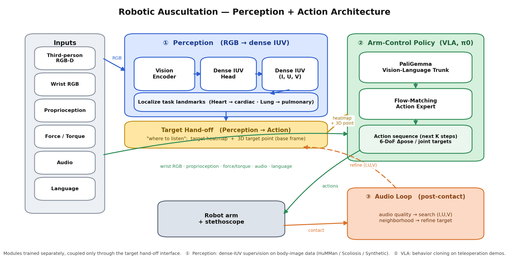
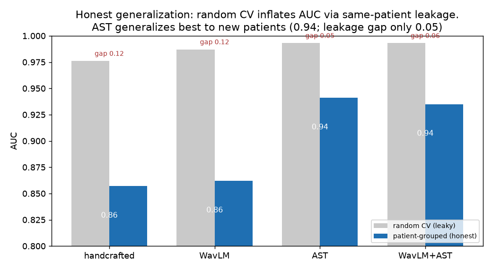
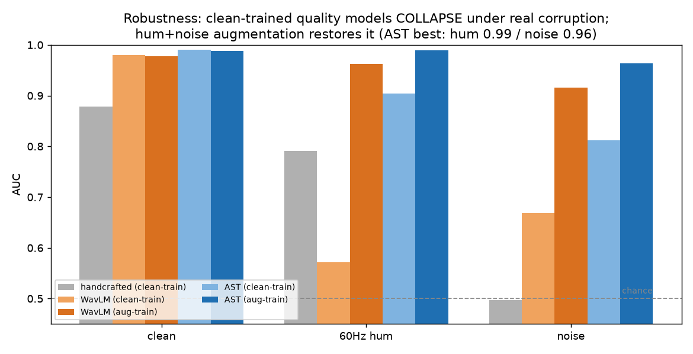

# Robotic Auscultation

[](https://github.com/WilliamQiuzy/robotic-auscultation/actions/workflows/tests.yml)


A robot that performs posterior lung auscultation. It finds the ten standard listening points on a
seated patient's back, places a spring-loaded digital stethoscope on each one with controlled force,
and judges whether the recording is good enough to use.

Research project at the Rajpurkar Lab, Harvard University (May 2026 to present).
**This is active, unfinished work.** The perception, audio, hardware and simulation pieces below are
working; a learned closed-loop policy is still being developed, and this repository is updated as the
project moves forward.

<p align="center">
  
</p>

## Approach

Existing robotic auscultation systems reduce the task to "locate a 3D point, then move the stethoscope
there", with the point coming from an anatomical atlas, a registered body mesh or a network. Clinicians
work differently: they listen while they move, compare left and right, and adjust pressure until the
sound is clear. This project treats auscultation as a sensorimotor task with sound in the loop:

1. **Perception** turns camera frames into the ten auscultation points and keeps them locked to the
   same anatomy while the patient breathes and shifts.
2. **An arm-control policy** approaches, makes contact, holds a target force and records.
3. **A recording-quality model** decides whether the clip is usable, which tells the policy whether to
   stay or search the neighbourhood.

## What is in place

| Component | What it does | Code |
|---|---|---|
| Point detection and tracking | DINOv2 ViT-B with LoRA and a 10-landmark head that reads a depth-derived surface-normal map, so clothing colour and texture never enter the input. A model-based tracker fits one similarity pose to all ten points each frame (weighted Umeyama with IRLS outlier rejection) and flags, per point, whether it was actually observed. Held-out real frames: PCK@5 = 98%; per-frame jitter cut from 2.8 mm to 1.0 mm at about 33 ms lag. | [`auscultation/ausc/perception`](auscultation/ausc/perception/tracking) |
| Recording-quality model | AST embeddings with a gradient-boosted head flag unusable lung-sound clips. On SPRSound (4,960 clips, 382 patients) it reaches AUC 0.94 on a patient-grouped split, against 0.86 for WavLM. Training with hum and noise augmentation keeps AUC at 0.96 or higher under those corruptions. | [`auscultation/ausc/audio`](auscultation/ausc/audio), [results](auscultation/docs/sprsound_quality_loop_RESULTS.md) |
| Force-sensing end effector | Parametric CadQuery models of a passive spring mount around a Thinklabs One digital stethoscope. A coaxial magnet and an SS49E Hall sensor measure spring compression, read by an Arduino. | [`auscultation/mechanical_sensor`](auscultation/mechanical_sensor) |
| Real-arm data collection | Leader-follower teleoperation of an OpenArm at 1 kHz over CAN, a C++ telemetry publisher on a preallocated lock-free ring patched into `openarm_can`, hand-eye calibration, and a force-limited safety state machine. | [`auscultation/openarm_bridge`](auscultation/openarm_bridge), [`auscultation/scripts`](auscultation/scripts) |
| Simulation and expert | NVIDIA Isaac Sim 5.1 digital twin of the seated-patient task: the OpenArm with its gripper replaced by a stethoscope on a preloaded prismatic spring joint, clearance, joint-limit and contact-force gates, and an analytic expert (collision-checked motion planning with Ruckig trajectories, plus force feedback) that labels demonstrations for imitation learning. | [`sim/ausc_policy`](sim/ausc_policy), [`configs/ausc_policy`](configs/ausc_policy) |

Earlier policy experiments (π0.5 fine-tuning, ACT and other baselines) live in the versioned
`sim/auscultation_*` directories. They are kept read-only because the current code imports parts of
them and their results are referenced by content digest.

## Recording-quality results

<p align="center">
  
  
</p>

Random cross-validation inflates AUC because clips from the same patient land in both train and test.
On a patient-grouped split, AST generalizes best (0.94, leakage gap 0.05). Models trained on clean audio
collapse under 60 Hz hum and noise; augmenting with the corruptions expected at the bedside restores them.

## Repository layout

```
auscultation/
  ausc/               perception, audio, datasets and training (Python package)
  mechanical_sensor/  end-effector CAD, Hall-sensor firmware, contact simulations
  openarm_bridge/     C++ telemetry patches and test harnesses for the OpenArm CAN stack
  scripts/            data collection, deployment to the robot PC, audio studies
  docs/               design notes and experiment write-ups
sim/
  ausc_policy/        current simulation, expert and policy code
  auscultation_*/     earlier iterations, kept read-only
configs/ausc_policy/  experiment configurations
reports/ausc_policy/  experiment reports
tests/                tests for sim/ausc_policy
```

Some design notes and experiment reports are written in Chinese.

## Running the tests

The simulation, expert, policy, point-tracking and robot-safety tests run on CPU with no robot, camera
or GPU:

```sh
python3.11 -m venv .venv && source .venv/bin/activate
pip install -r requirements-ci.txt
pip install torch==2.14.1 --index-url https://download.pytorch.org/whl/cpu

pytest tests                                   # simulation, expert and policy logic
cd auscultation && pytest ausc/perception/tracking/tests ausc/perception/robot/tests
```

CI skips the few test files that need simulator assets kept out of git, and runs a handful of property
tests with open issues as a non-blocking step; [the workflow](.github/workflows/tests.yml) lists them.
Isaac Sim runs need Linux, an NVIDIA GPU and Isaac Sim 5.1.

## What is not included

- No images, video or audio of people, no patient data and no model weights.
- Datasets (HuMMan, SMPL body models, SPRSound and others) must be obtained from their owners under
  their own licences; the scripts expect them under `auscultation/data/`.
- Server and lab-network configuration.

## Acknowledgements

The OpenArm robot description and CAN stack are by Enactic, Inc. (Apache License 2.0); the patches in
`auscultation/openarm_bridge` apply to `openarm_can` 1.2.2. The project also builds on DINOv2, the Audio
Spectrogram Transformer, LeRobot, openpi, cuRobo and Ruckig, and uses the SPRSound and HuMMan datasets.

## Author

Ziyue (William) Qiu, Harvard University
