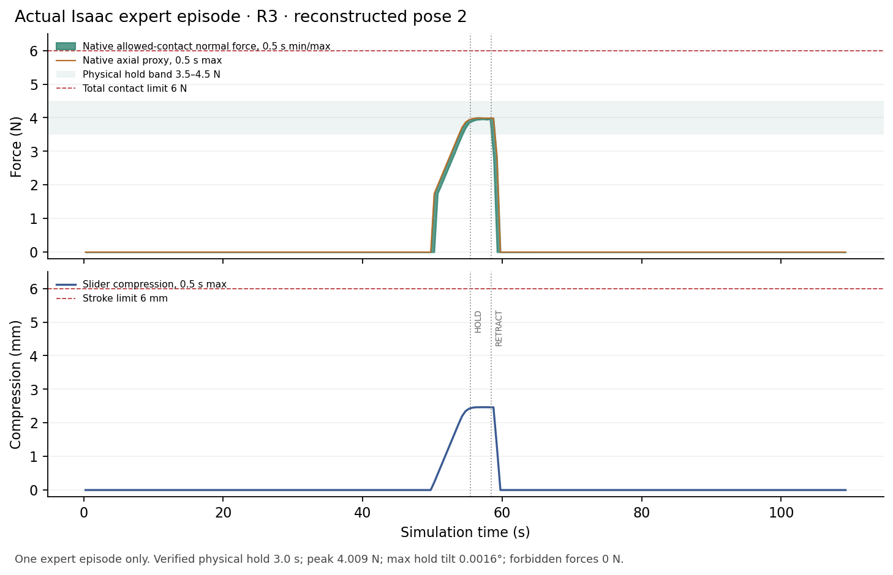
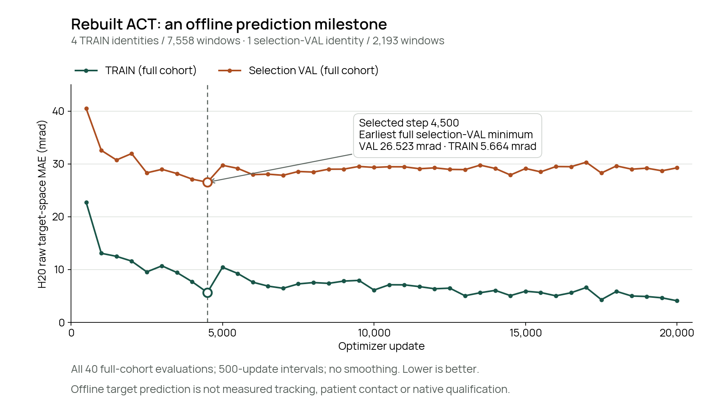

# A rebuilt experiment, a rejected STOP, and two different force signals

**Draft for the November 5, 2026 experiment update. Not linked from the live demo.** The latest evidence in this draft is dated November 6 UTC, still November 5 in New York. The new ACT fit has completed 20,000 updates and full-cohort CPU equivalence. Its offline summary is dated **02:43:22 UTC on November 6**. Subsequent TRAIN/selection native diagnostics are authenticated **2/2** and physically qualified **0/2** under the original posture gate. They are a separate diagnostic cohort; all **24 frozen comparison slots remain pending**, and Astra native behavior has not yet been tested.

The rebuild has produced one useful native regression result: a repaired expert episode reached its contact task, completed the required hold and returned a successful child result. Separately, CPU replay explains two issues that could otherwise be mistaken for model failures: a STOP profile can report completion while violating our numerical endpoint check, and a decoded Hall spring-load estimate can remain nonzero when the native contact proxy is zero. The later ACT fit below adds an offline prediction result, with native tracking and contact qualification still separate.

## Research question

Can we rebuild the experiment on a replacement runtime, preserve the original physical gates, and obtain a fair expert/ACT/Astra comparison? The old Pod was deleted. The original training arrays and ACT weights have not been recovered, so this work starts a new reconstruction epoch. The historical public expert **8/8** and ACT **0/2** remain [historical results](../data/results.json), with their original cohorts and artifacts.

The immediate question is therefore whether the new source, scene preparation, recording and control chain support new experiments. Recreating a file, passing a CPU replay or starting an inference service does not answer the later question of model performance.

## Attempt and configuration

The reconstructed scope has four TRAIN identities, one checkpoint-selection VAL identity and two identities reserved for frozen evaluation. Each uses the same two existing observed poses. The reconstruction receipt is complete, but explicitly leaves physics, seat support, IK, static scene QA and training eligibility unqualified. It also records that the original depth-plane bytes were not recovered. This is reconstruction from available source inputs, not restoration of the lost dataset. **[E1]**

A new native contact witness was issued from a completed, terminal native run. Its scope is shape-0 witness semantics and conservative six-face classification for the specified retainer/body geometry. It does not requalify an expert episode, validate a model or change old run verdicts. **[E2]**

The repaired V2 collection uses immutable source version 7: **20 declared slots, 18 native jobs and two geometrically unavailable slots retained in the denominator**. The two unavailable cases are not robot successes or native execution failures. The later training summary uses 18 positive expert episodes from this rebuilt scope, with the two geometric absences retained in the 20-slot plan. Individual DONE/return-home reports were never treated as a terminal aggregate score; this draft reports the accepted offline data scope rather than a new frozen expert success rate.

## Result 1: keep the STOP failure, change the planning request

The earlier fresh collection encountered a STOP preview whose trajectory generator reported `Finished` but failed the unchanged 64-ULP stationary endpoint check. The original-prefix replay receipt preserves the issued prefix exactly. Its first rejected R3 STOP diagnostic found a joint-position residual of about **3.20 × 10⁻¹¹ rad**, against a bound of about **1.42 × 10⁻¹⁴ rad**. A subsequent L3 counterexample also exposed a small finite-difference jerk overshoot when continuing the original waypoint after the rejected preview.

The repair does not enlarge either acceptance bound. A narrowly typed rejection may be handled only in a read-only STOP hypothesis. The ordinary checked approach continues to the next fresh 20 Hz candidate, with waiting, STOP and settling sharing the original five-second budget. Current L2 planning requests jerk **1.4999 rad/s³** rather than **1.5**, reserving numerical margin while leaving the physical acceptance limit unchanged.

Actual Linux CPU receipts under that requested profile show:

| Recorded schedule used for the hypothesis | Maximum command jerk | Wait ticks | STOP ticks | Total parking ticks |
| --- | ---: | ---: | ---: | ---: |
| R3 | 1.4999000109 rad/s³ | 24 | 1 | 49 |
| L3 | 1.4999000232 rad/s³ | 12 | 9 | 45 |

These are **counterfactual command schedules, not new physical executions**. Both receipts say `physics_executed: false`, `physical_qualification: false`, and `all_issued_commands_bit_identical: false`. The maximum command difference from the archived schedule is about **1.94 × 10⁻⁶ rad**. Future measured geometry and settling are not verified by this replay, and the original failed verdicts remain unchanged. **[E3, E4, E11]**

### One subsequent native expert episode

A newly recorded **TRAIN identity / pose 2 / R3** episode from the repaired V2 collection has now completed with child exit code 0, `worker_complete: true` and `physical_pass: true`. Its native result reports `success: true`, `physical_validation: true` and complete compact capture. The reported contact-force peak is **4.009271 N**, forbidden contact force is **0 N**, the joint force-and-plane hold is **3.0 s**, and maximum hold-plane tilt is **0.001605°**. These are one expert episode's native result fields, not a completed independent aggregate audit. **[E10]**

[Watch the actual recorded expert episode](assets/repaired-expert-pose2-r3-20261106.mp4).

**Video caption:** One repaired analytic expert episode, TRAIN identity `p001120`, second observed pose, target R3. The MP4 uses the original recorded RGB observations, one frame per 20 Hz observation, with no new simulator rendering. It contains **2,190 frames at 256 × 144, 20 fps, 109.5 s** of simulation-time playback. The recording reader passed 2,190 frames plus one terminal observation. Recording integrity is not physical training qualification. This recording was inspected while collection was active; the clip itself is neither an aggregate expert score nor ACT/Astra acceptance. **[E8, E9]**

**Chart caption:** The same one-episode expert recording. Shaded ranges preserve 0.5-second minimum/maximum normal-force bins; the orange trace is the **native axial proxy**, not the ADC-decoded spring preload estimate discussed below. The force-and-plane HOLD runs from **55.4625 to 58.4625 simulated seconds**. Peak stroke is **2.466 mm**, below the unchanged 6 mm gate. The [small aggregate summary](evidence/expert-pose2-r3-minmax-summary.public.json) retains transitions and native audit summaries; no raw stream is included. See also the [vector chart](assets/expert-pose2-r3-physics.svg). This chart does not qualify the running dataset or a learned policy. **[E12]**

**Causal stage check.** The original recording reader and `given.assemble_samples` were also run on this closed worker. They read **2,190 frames / 26,280 native rows** and assembled **532 full, same-owner causal H20 windows**, all in `given_l2_motion`. Native actor accounting remains separate: PREPARATION **240**, TEACHER_L2 **6,924**, L2_STOP **25**, ANALYTIC_L3_ALIGN **243**, and ANALYTIC_L3 **18,848** rows. STOP, alignment and contact rows are not promoted into learned-L2 labels. This component diagnostic wrote no training arrays and did not issue owner physical qualification; strict collection-wide export was still pending at that diagnostic cutoff. The later completed ACT summary below binds the subsequent accepted dataset. **[E13]**

Playback is **1× simulation time**. The original episode took approximately **1,269.829 wall seconds**, excluding Kit startup and teardown, so this is not a real time performance claim. The poster is an original recorded HOLD frame at 55.6 simulated seconds. Future Astra clips must identify omitted inference pauses and report LLM latency separately from simulated motion time. **[E14]**

This clip is separate from the frozen eight-scenario cohort and must not populate any of its result slots.

## Result 2: the lower Hall boundary can be repaired without changing the recorded physics

These sensor diagnostics use the retained first-pose R3 capture from the earlier V1 collection. They are separate from the repaired pose-2 V2 video and chart above, and do not retroactively qualify that earlier collection.

CPU replay covered **26,980 actual recorded native rows**, approximately **112.42 simulated seconds**. Raw compression was slightly negative in **3,045 rows**, reaching **−1.864278 × 10⁻⁶ m**. The new Astra observer initially rejected even the first such row as outside calibrated travel. **[E5]**

The compact capture path already had a deterministic ADC-equivalent lower-end rule. Reusing that rule maps a tiny negative residual to zero only at the forward sensor-model input. Its existing bound is **3.809856 × 10⁻⁶ m**, derived from the native ADC quantizer and pinned calibration slope. Raw measured compression, native state, upper travel domain and physical gates remain unchanged.

The candidate replay made **zero input-mapping differences and zero full-packet differences** against the recorded capture model. Across **2,248 saved Hall observations**, ADC values matched exactly, and maximum voltage and decoded-force residuals were both zero. These checks establish consistency with the recorded sensor model; they do not establish hardware calibration, useful model attention to Hall, or a native Astra rollout. **[E5, E6]**

## Result 3: spring preload is not patient pressure

During the initial settle, the decoded simulated Hall spring-load estimate is **1.497564 N**, while the native axial contact proxy is **0 N**. The two signals describe different quantities. A preloaded spring can carry load before external patient contact; the decoded signal must not be relabeled as measured surface-normal pressure or substituted for the native contact-force success gate.

During recorded HOLD, mean decoded spring load was approximately **4.020377 N**, versus **3.982442 N** for the native proxy. That agreement in one operating phase does not erase the difference at rest. The Hall signal is explicitly simulated ADC, the operating curve is spring-anchored, and `bench_verified` remains false. **[E5, E6]**

This finding changes how observations should be explained to a supervisor. It does not justify changing the original force controller or physical acceptance thresholds.

## Result 4: depth is a measurement, not an anatomical target estimator

The stored compact depth is **256 × 144**, quantized at **0.1 mm**, with **93.636% valid pixels** in this recorded case. Invalid samples are stored as zero with a false validity mask; the original invalid sentinel values are not retained. The existing 640 × 360 helper correctly rejects this different shape. A diagnostic summary of the actual stored resolution is not qualification of the new native Astra camera path. **[E5]**

The depth probe is selected by projecting the prescribed reference pose. During the first recorded HOLD frame, its optical Z is **0.4773 m**, while prescribed-reference Z is **0.532426 m**: the observed surface is about **55.13 mm in front**. Foreground tool occlusion is a plausible explanation, not a proven classification of that pixel. A numerically correct backprojection does not make the pixel an independent anatomical estimate. **[E5]**

The next native observer check must preserve actual camera dimensions, intrinsics, units, validity and frame/physics binding. Resizing an old saved map would not prove that contract.

## Result 5: a completed ACT fit is an offline model milestone

The rebuilt state-only ACT run completed **20,000 optimizer updates**. The experiment owner reports a normal training exit with the original process group drained and GPU released; the bound summary names that owner receipt by SHA256. Checkpoint selection used the **earliest minimum full-selection-VAL H20 raw-target MAE**, selecting **step 4,500**, rather than the last update. The [public scalar extract](evidence/rebuilt-act-offline-20261106.public.json) preserves all **40 full TRAIN/selection-VAL evaluations**, every 500 updates, and logical-name/bytes/SHA256 references for the training, owner, dataset, selected weights and CPU-equivalence receipts. No arrays or weights were downloaded.

The selected checkpoint's H20 raw-target MAE is **5.66401778 mrad on TRAIN** and **26.52257142 mrad on selection VAL**. These are errors between predicted and recorded absolute joint targets. They are **not measured robot tracking error, contact-force accuracy or native physical success**.

**Training curve caption:** Exact full-cohort evaluations at 500-update intervals from step 500 through 20,000; both curves contain all 40 points, with no smoothing or interpolation beyond joining adjacent observations. The dashed line and outlined points mark selected step 4,500, the earliest full-selection-VAL minimum. Values are converted from radians to **mrad** by multiplying by 1,000. Lower is better for this offline H20 raw-target MAE; the figure does not qualify native tracking or contact. The [vector figure](assets/rebuilt-act-training-20261106.svg), [scalar source extract](evidence/rebuilt-act-offline-20261106.public.json) and [reproduction script](analysis/plot_rebuilt_act_training.py) and [figure manifest](evidence/rebuilt-act-training-20261106.figure.json) are available. On a narrow screen, scroll the figure horizontally or open the vector file.

The export contains **14 TRAIN episodes / 7,558 H20 windows** from four TRAIN identities and **four selection-VAL episodes / 2,193 H20 windows** from one selection identity. It covers the same two known observed poses and R3/L3 targets: **18 actual positive expert episodes**, within **20 planned data slots** with **two geometric absences** retained. This data denominator is separate from the eight frozen comparison scenarios. Full checkpoint CPU equivalence passed across all **7,558 TRAIN** and **2,193 selection-VAL** prediction windows, under the recorded combined absolute/relative tolerances. It checks checkpoint loading and prediction/metric agreement, not native robot execution.

The experiment owner reports whole-owner wall times of **2 h 26 min 26.748 s** for the completed V2 collection and **16 min 11.103 s** for training, with GPU release recorded at both ends. These are batch/job wall clocks, separate from the earlier single episode's 1,269.829 probe wall seconds and its 109.5 simulated seconds; no throughput target is presented as achieved.

The actual HOLD and constant-velocity baselines below were evaluated on those same exported cohorts and H20 target-space metric. They are not physical controllers or a comparison against the earlier public training cohort.

| Offline H20 target MAE (mrad) | TRAIN, 7,558 windows | Selection VAL, 2,193 windows |
| --- | ---: | ---: |
| ACT, selected step 4,500 | 5.664018 | 26.522571 |
| HOLD target baseline | 152.064061 | 150.095436 |
| Constant-velocity target baseline | 138.282261 | 136.491593 |

ACT learns **state-only L2 approach targets**; the original analytic L3 alignment, contact, hold, release and home assistance remains explicit. RGB, depth and Hall are not ACT model inputs. This fit uses one selection-VAL identity in known poses, with no independent frozen-identity native score, sealed TEST result, broad population claim or clinical qualification. The older public MAE comes from a different cohort and is not used as a controlled gain estimate.

The offline summary above preceded the subsequently closed native smoke diagnostics below. Astra native behavior has not yet been tested. The **eight frozen scenarios × three methods = 24 slots all remain pending**.

## Result 6: retain the native TRAIN/selection physical rejections

The subsequent source9 diagnostic receipts authenticate **both actual native model episodes: 2/2**, including the original model/checkpoint identity and closed traces. The original physical qualifier accepts **0/2**. Both episodes report **`R3: command posture rejected: posture_joint_envelope`**. The [public smoke extract](evidence/rebuilt-act-native-smokes-20261106.public.json) binds both original small receipts by SHA256; its checkpoint and training-complete hashes match the selected offline model above.

| Diagnostic cohort / target | Actual CPU model responses | Recorded executed actions | Original physical verdict |
| --- | ---: | ---: | --- |
| TRAIN `p001120`, first known pose / R3 | 92 | 907 | Rejected: `posture_joint_envelope` |
| Selection VAL `p000923`, first known pose / R3 | 95 | 935 | Rejected: `posture_joint_envelope` |

The receipts report no native-terminal or trace-authentication errors and explicitly record that the model was exercised. Those execution counters are not contact-task success. The failures are actual physical qualification negatives in this new TRAIN/selection diagnostic cohort, separate from both the historical ACT 0/2 and the frozen eight-scenario comparison.

**Read-only CPU diagnosis.** A separately completed [small diagnostic summary](evidence/rebuilt-act-smoke-diagnosis-20261106.public.json) reconstructs **all 187 observed requests** with byte-identical singleton H20 responses, maximum difference **0**. Current/previous state17 encodings and clocks also agree exactly in the inspected frames. This supports the actual loaded-model/input chain in these two episodes; it is not native success or proof of general cause.

The actual native TCP came within **2.8544 cm (TRAIN)** and **1.5371 cm (selection VAL)** of the goal before ending **16.5535 cm** and **16.4220 cm** away. The last issued joint-6 commands remained legal, about **0.00001003 rad** and **0.00001689 rad** inside the original **−0.733038 rad** lower bound. Final H20 targets lay beyond that bound. The original posture precheck rejected the next interpolated command before the next physics tick; the exact rejected command was not recorded, so it is not reported as an issued target or measured violation. The same TRAIN scene/reference's original physically valid expert L2 trace reached only **−0.430667 rad** at joint 6. These observations support closed-loop drift in the two inspected cases rather than a missing checkpoint or encoder mismatch; they do not isolate a causal repair, establish data coverage or consult frozen outcomes.

These diagnostics do not add an all-pass admission gate. The unchanged failure-aware workflow continues to the fixed comparison after model/source authentication, original owner checks and safely closed traces, preserving both physical rejections. The original expert frozen owner has started; no final frozen case outcome is supplied in this draft. **All 24 frozen method slots remain pending.** No new threshold, rescue policy or replacement scenario is introduced.

## System roles and simulation limits

The planned comparison evaluates these complete systems under the same original physical contract. Their learned and analytic roles differ:

| System | Model or decision role | Analytic motor assistance | Frozen results here |
| --- | --- | --- | --- |
| Expert | Prescribed plans and analytic controller | GivenContactExpert approach, alignment, contact, hold, release and home | Eight slots pending |
| ACT | State-only learned L2 approach targets | Original analytic L3 alignment, contact, hold, release and home | Eight slots pending |
| Astra + GivenContactExpert | `gpt-6-astra` chooses guarded local skills from RGB, calibrated depth summaries, simulated Hall and joint state | GivenContactExpert executes the actual local motor/contact trajectories | Eight slots pending; native Astra not yet tested |

The [real-robot evidence gap](../real_world_gap_20261105.md) lists the missing tool, Hall/load, timing, RGB-D, surface and acoustic measurements and the next learning evidence. The two frozen body identities use known poses and R3/L3, not a complete ten-point sequence or unseen pose families. Simulation contact gates do not establish acoustic quality or clinical safety; the fixed force band is a benchmark condition rather than a force recommendation for people.

## Limits and current work

| Work item at this draft's cutoff | Status | What remains |
| --- | --- | --- |
| Reconstruction receipt | Complete | Separate scene/physics and data acceptance |
| Fresh native contact witness | Qualified within its stated semantics | No expert/model qualification inferred |
| STOP and Hall replay diagnostics | Complete, CPU only | Native regression and sensor binding |
| Repaired TRAIN pose-2 R3 expert child | Completed native result; recording integrity passed | One episode, separate from frozen model qualification |
| Rebuilt expert data for this fit | 18 positive episodes: 14 TRAIN / four selection VAL; two geometric absences in 20 planned slots | Keep data scope separate from the frozen eight-scenario benchmark |
| Official ACT, 20,000 updates | Completed; step 4,500 selected; full CPU equivalence passed | Native tracking/contact verdict and independent frozen comparison |
| ACT TRAIN/selection smokes | Two authenticated closed episodes; 0/2 original physical qualification, both posture-envelope rejections | Read-only diagnosis; preserve negatives separately from the frozen cohort |
| Astra native rollout | Not yet tested | Actual invocation, sensor binding and original physical audit |
| Frozen matched expert/ACT/Astra comparison | Original expert owner started; all 24 method slots pending in this draft | Actual terminal executions, failures, coverage and independent audits |

The evaluation runtime is separately frozen as source8 (`cf551566c0285a086d197553cee3299f4444f464`); the completed collection/training lineage retains source7, while native diagnostics and the continuing comparison use source9. A source freeze and CPU checks do not establish a new physical model result. The [source8 export draft](source8-publication-allowlist.md) records the exact candidate dependencies and the remaining native verification/publication boundary.

The frozen case manifest contains **two identities × two poses × R3/L3 = eight scenarios**, and explicitly records that model outcomes were not consulted. That is a source-preparation receipt, not eight physical successes. TRAIN and checkpoint-selection VAL results will remain separate from this small frozen-identity comparison. Even a completed comparison would not establish broad population or clinical generalization. **[E7]**

## Next step and publication rule

Retain the completed fit, its selected checkpoint and accepted-data source bindings, with all 20 planned data slots including geometric absences preserved. Retain the two completed diagnostic physical rejections and complete the original frozen native owners and independent audit before reporting frozen outcomes. TRAIN/selection smokes are diagnostic: after strict authentication, model/source identity, original owner and safely closed trace checks, a smoke physical rejection is retained as a negative result. There is no extra requirement for both smokes to pass physically before the fixed comparison. The source9 workflow makes this operator-only correction before any smoke or frozen-model outcome; every per-case physical qualifier and all eight scenarios remain unchanged. A negative smoke does not establish a usable model. Evaluate the frozen eight without changing its cases after observing model outcomes.

For publication, append a new cohort artifact using the [matched result template](../../benchmarks/matched-eight-results-v1.template.json) and its [schema](../../benchmarks/matched-eight-results-v1.schema.json). Keep all eight scenario slots and all three methods. Unknown outcomes and unavailable videos stay null or explicitly unavailable; only independently audited terminal results may become success counts. The [append guide](../../benchmarks/MATCHED_RESULTS_APPEND.md) lists the exact update commands and evidence required. Do not rewrite the historical result JSON or replace the existing two public clips.

## Evidence record

The small [selected-field evidence extract](evidence/rebuild-diagnostics-20261105.json) contains E1–E14, original receipt byte counts and SHA256 identifiers. It removes host addresses and absolute native paths. Original full receipts and raw arrays remain with the experiment owner; the extract does not independently rerun them. The STOP endpoint diagnosis is additionally documented in the development source notes; the public extract intentionally retains only the bounded summary fields rather than command arrays.

The separate [offline scalar extract](evidence/rebuilt-act-offline-20261106.public.json) binds the 224,418-byte training summary by SHA256 and keeps only aggregate errors, cohort counts, CPU-equivalence fields and logical artifact references. It contains no private source paths or network endpoints. The curve is reproducible from this extract alone. The separate [native smoke extract](evidence/rebuilt-act-native-smokes-20261106.public.json) binds the 2,002-byte authentication receipt and 4,886-byte diagnostic receipt, preserving the two physically negative cases and logical artifact hashes. It does not populate frozen benchmark slots.

No human raw data, body meshes, source RGB/depth arrays, training arrays, weights, credentials or complete simulator environment accompany this draft. The visual assets are the scoped expert recording, its original HOLD frame, and aggregate physics/training plots.
